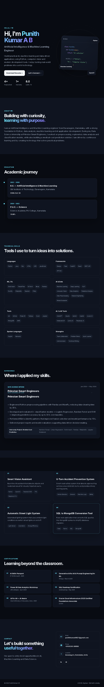

# Punith Kumar — AI/ML Engineer Portfolio

A modern, responsive personal portfolio website built to showcase my AI, Machine Learning, Data Science, and Full-Stack projects.

Built with **React**, **TypeScript**, **Vite**, **Tailwind CSS**, **Motion**, and **GSAP**.



## Live Demo

- Portfolio: `https://your-portfolio-url.vercel.app`
- GitHub: [https://github.com/punithkumar0927-ctrl](https://github.com/punithkumar0927-ctrl)
- LinkedIn: `https://www.linkedin.com/in/your-linkedin-username`
- Email: `your-email@example.com`

## About

This portfolio highlights my work in Artificial Intelligence, Machine Learning, Deep Learning, Data Analysis, and web development. It includes my technical skills, professional experience, featured projects, certifications, and contact information.

The website is fully responsive and optimized for desktop, tablet, and mobile devices.

## Tech Stack

- **Frontend:** React, TypeScript, Vite
- **Styling:** Tailwind CSS
- **Animations:** Motion, GSAP
- **Deployment:** Vercel / Netlify
- **Version Control:** Git, GitHub

## Features

- Responsive modern portfolio design
- Animated user interface using Motion and GSAP
- About, Skills, Experience, Projects, and Contact sections
- Downloadable resume
- Direct email and social media links
- Fast performance using Vite
- Easy content customization through `src/data.ts`
- Production-ready build setup

## Featured Projects

| Project | Description | Tech Stack | Links |
|---|---|---|---|
| AI Project 1 | Short description of the problem solved and result achieved | Python, TensorFlow, scikit-learn | [GitHub](https://github.com/punithkumar0927-ctrl/project-1) |
| AI Project 2 | Short description of the problem solved and result achieved | Python, Pandas, Streamlit | [GitHub](https://github.com/punithkumar0927-ctrl/project-2) |
| Web Project 1 | Short description of the web application and key features | React, TypeScript, Tailwind CSS | [GitHub](https://github.com/punithkumar0927-ctrl/project-3) |

> Replace the project names, descriptions, links, and tech stacks with your real repositories.

## Project Structure

```text
PunithKumar-AI-Portfolio/
├── public/
├── src/
│   ├── components/
│   ├── data.ts
│   ├── App.tsx
│   └── main.tsx
├── portfolio_preview.png
├── package.json
├── tailwind.config.js
├── tsconfig.json
└── vite.config.ts
```

## Getting Started

### Prerequisites

Make sure you have the following installed:

- Node.js
- npm or yarn
- Git

### Installation

```bash
git clone [https://github.com/punithkumar0927-ctrl/PunithKumar-AI-Portfolio.git](https://github.com/punithkumar0927-ctrl/PunithKumar-AI-Portfolio.git)
cd PunithKumar-AI-Portfolio
npm install
```

### Run Locally

```bash
npm run dev
```

Then open the local development URL shown in your terminal, usually:

```text
http://localhost:5173
```

## Customization

### Update Portfolio Content

Most of the portfolio content can be updated from:

```text
src/data.ts
```

You can update:

- Personal information
- Skills
- Work experience
- Projects
- Certifications
- Social links
- Contact details

### Update Main Sections

For layout or section-level changes, edit:

```text
src/App.tsx
```

### Update Resume

Place your updated resume PDF in the project and update the import path in the relevant component.

Example:

```text
src/assets/Punith_Kumar_Resume.pdf
```

## Build for Production

```bash
npm run build
```

The optimized production files will be generated in the `dist/` folder.

## Deployment

### Deploy to Vercel

1. Push this repository to GitHub.
2. Go to [Vercel](https://vercel.com).
3. Import the GitHub repository.
4. Vercel will automatically detect Vite.
5. Click **Deploy**.

### Deploy to Netlify

1. Push this repository to GitHub.
2. Go to [Netlify](https://netlify.com).
3. Import the repository.
4. Use the following build settings:

```text
Build command: npm run build
Publish directory: dist
```

5. Click **Deploy**.

## Contributing

This is a personal portfolio project, but suggestions and feedback are welcome.

1. Fork the repository
2. Create a new branch
3. Make your changes
4. Submit a pull request

## License

This project is licensed under the MIT License.

## Contact

- **Name:** Punith Kumar
- **Location:** Davangere, Karnataka, India
- **Email:** `your-email@example.com`
- **GitHub:** [punithkumar0927-ctrl](https://github.com/punithkumar0927-ctrl)
- **LinkedIn:** `https://www.linkedin.com/in/your-linkedin-username`

If you like this portfolio, please consider giving the repository a star.
